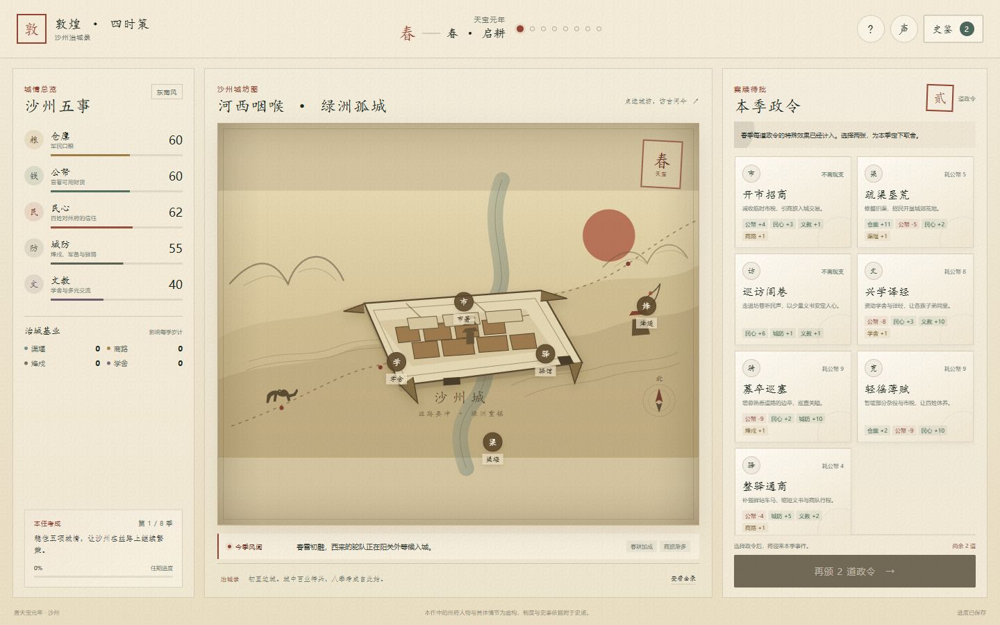
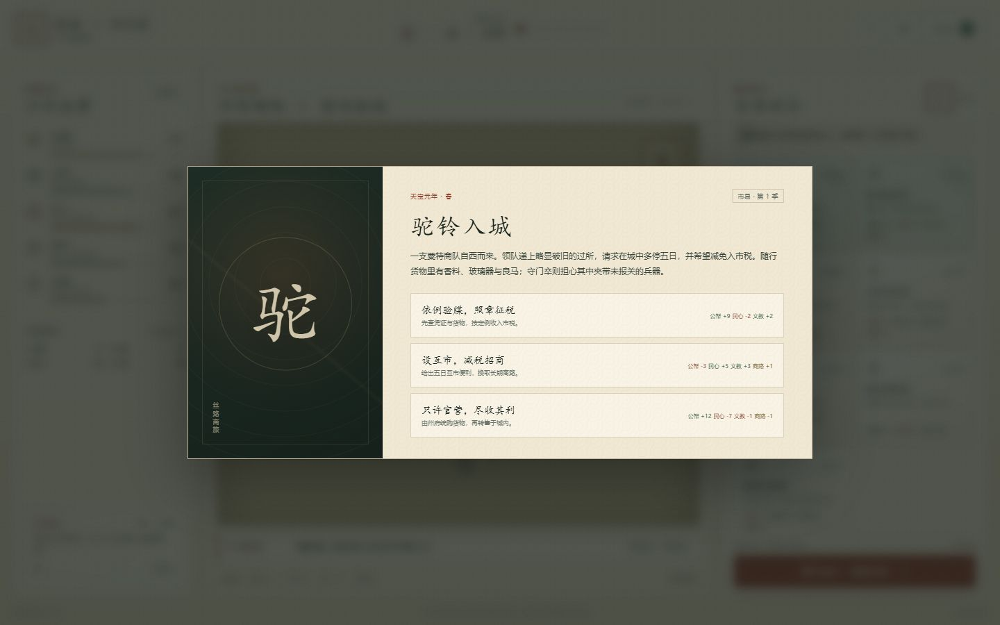
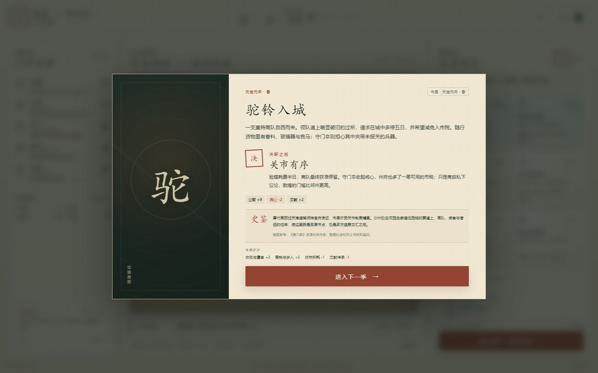
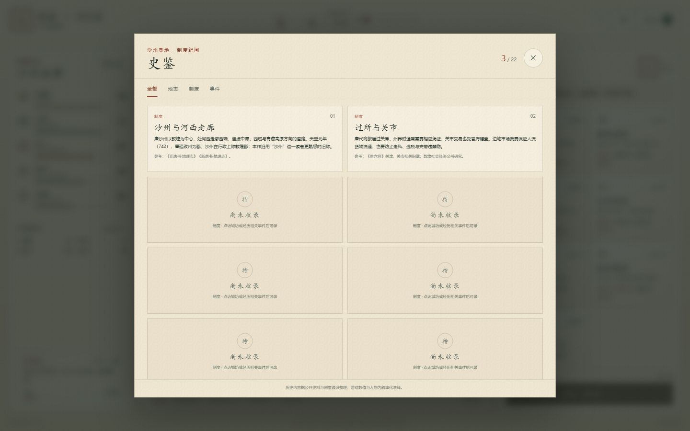

<div align="center">
  

  # Silk Road Seasons

  ### A Dunhuang Chronicle · 敦煌 · 四时策

  **A compact historical strategy game about keeping an oasis city alive.**

  [](LICENSE)
  
  
  

  **[Play in your browser →](https://zhuanght-1201.github.io/silk-road-seasons/)**
</div>


> In **742 CE**, the first year of the Tianbao era, Shazhou sits at the western edge of the Hexi Corridor. Caravans enter through its gates, mountain snow feeds its fields, and the beacon towers watch the road beyond.
>
> You have eight seasons to govern. Open the market or repair the canals. Fund the frontier garrison or protect the winter granary. Every choice changes the city that greets the next spring.

## About the game

**Silk Road Seasons** is a small, replayable historical strategy game set in Tang-era Dunhuang. It combines a light resource-management loop with narrative decisions, a seasonal policy deck, and collectible history notes.

No installation or build step is required beyond a local static server. The entire game is written in dependency-free HTML, CSS, and JavaScript.

### At a glance

- **8 seasons, one campaign** across the years 742–743.
- **2 policies per season**, chosen from a changing pool of 11.
- **5 city attributes**: grain, treasury, public trust, defense, and culture.
- **4 long-term foundations**: irrigation, trade routes, beacon networks, and schools.
- **8 historical dilemmas** with visible trade-offs and source-backed notes.
- **22 collectible archive entries** covering places, institutions, and events.
- **Seasonal modifiers, multiple endings, achievements, autosave, and sound**.
- **Responsive layout** for desktop, tablet, and narrow mobile screens.

## Screenshots

### Govern a living oasis



The city map, seasonal conditions, policy deck, and long-term foundations remain visible together. Policy effects are calculated for the current season.

### Make choices without a perfect answer

| Historical dilemma | Decision and history note |
| :---: | :---: |
| [](docs/screenshots/historical-event.png) | [](docs/screenshots/decision-and-history.png) |
| Each event presents competing interests and explicit consequences. | After a decision, the game explains the real institutions behind the fictional scene. |

### Build a historical archive



Click city landmarks and complete events to unlock concise notes about Tang frontier administration, markets, courier stations, beacon networks, irrigation, and cultural exchange.

## Quick start

Play the hosted version at **https://zhuanght-1201.github.io/silk-road-seasons/**.

To run the game locally:

```bash
git clone https://github.com/ZhuangHT-1201/silk-road-seasons.git
cd silk-road-seasons
npm start
```

Open **http://127.0.0.1:4173** in a modern browser.

You can also open `index.html` directly. The local server is included only to provide a predictable origin for browser storage.

## How to play

1. Choose exactly **two policies** each season.
2. Review the current season's modifiers and each policy's resource cost.
3. End the season to face a historical event.
4. Balance the five city attributes and invest in long-term foundations.
5. Inspect city landmarks to discover archive entries.
6. Finish all eight seasons to receive a score, rank, and achievements.

Any attribute reaching zero creates a crisis. Trade routes and irrigation improve later seasonal income, beacon networks reduce defensive decline, and schools support culture.

## Historical grounding

The game is a fictional governance simulation, not a reconstruction of a specific historical official's career. Its setting and institutional background draw on:

- 《唐六典》 and 《通典》 for Tang administrative and institutional context.
- 《旧唐书》 and 《新唐书》 for geography, military organization, and frontier finance.
- Dunhuang manuscripts and related scholarship for households, contracts, irrigation, and local society.
- Research on Tang courier, beacon, and market systems.

The game notes that in 742 the Tang court changed prefectures into commanderies; Shazhou was administratively called Dunhuang Commandery. The familiar name “Shazhou” is retained for narrative clarity and this distinction is explained in the in-game archive.

Every historical note includes a source note. Characters, dialogue, and the exact event outcomes are fictional.

## 中文简介

**《敦煌 · 四时策》** 是一款以唐天宝元年（742）沙州为背景的历史策略休闲游戏。你将在八个季节中颁行政令、处理边城事件，在仓廪、公帑、民心、城防与文教之间寻找平衡。

每季可以选择两道随季节变化的政令，随后面对一场没有标准答案的历史抉择。渠堰、商路、烽戍和学舍会持续影响之后的发展；点选城坊与经历事件则可收录 22 则史鉴。

游戏使用原生 HTML、CSS 和 JavaScript，没有第三方运行依赖，可直接部署为静态网站。人物和具体情节为虚构演绎，制度与史事背景附有资料说明。

## Project structure

```text
.
├── index.html                 # Game shell and interface
├── styles.css                # Visual system and responsive layout
├── game.js                   # Policies, events, resources, archive, saves
├── server.js                 # Dependency-free local static server
├── docs/screenshots/         # README screenshots captured from the game
├── CONTRIBUTING.md
└── LICENSE
```

## Development

```bash
npm start
```

There is no build process or package installation step. Edit the source files and refresh the browser.

When adding content:

- Keep new history notes factual, concise, and sourced.
- Mark fictional characters and narrative details clearly.
- Test both desktop and narrow mobile layouts.
- Verify a complete eight-season campaign after changing resource balance.

## Contributing

Issues and pull requests are welcome. Read [CONTRIBUTING.md](CONTRIBUTING.md) before opening a pull request. For substantial changes, open an issue first so the gameplay and historical scope can be discussed.

## License

Released under the [MIT License](LICENSE).

Copyright © 2026 Huiteng Zhuang.
